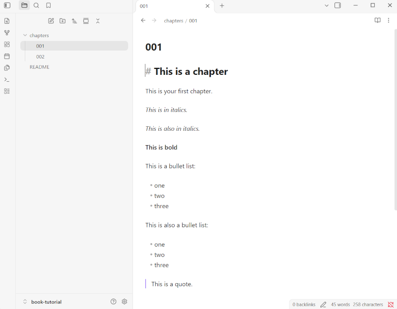
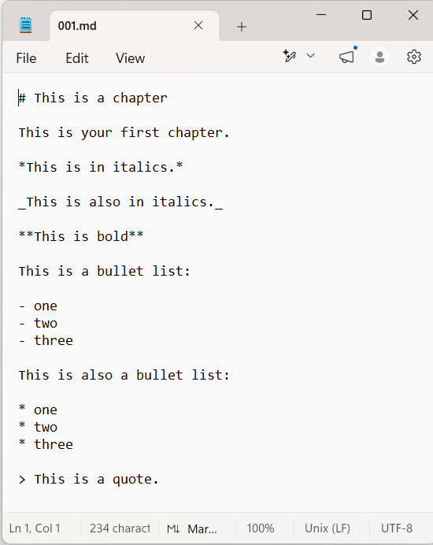
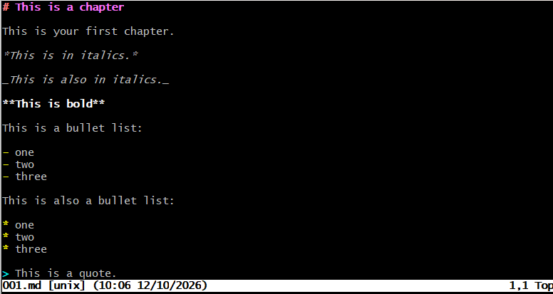
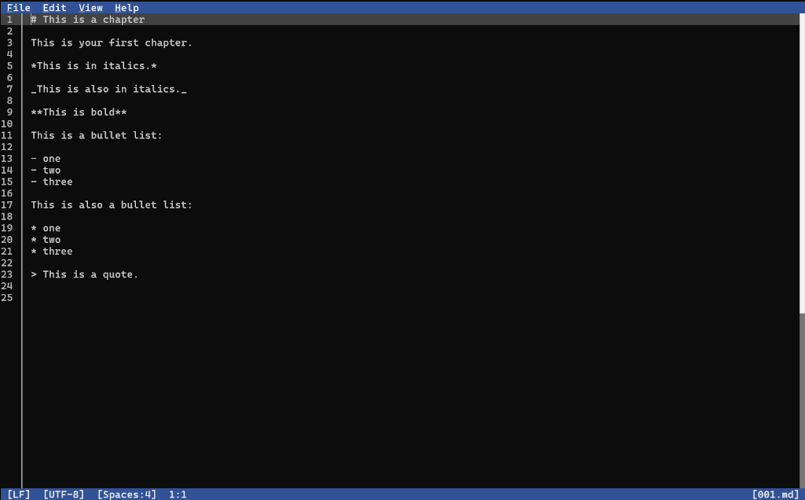
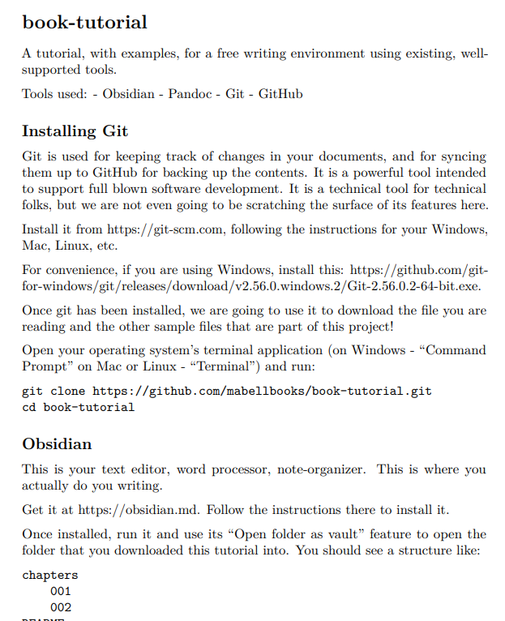
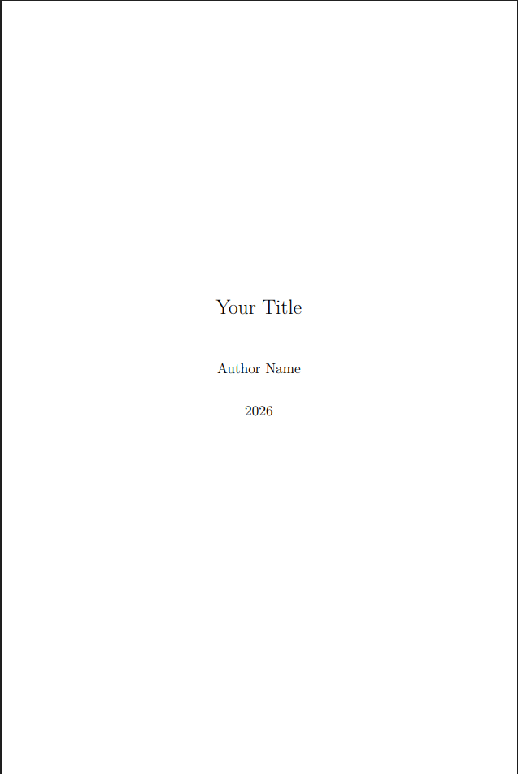
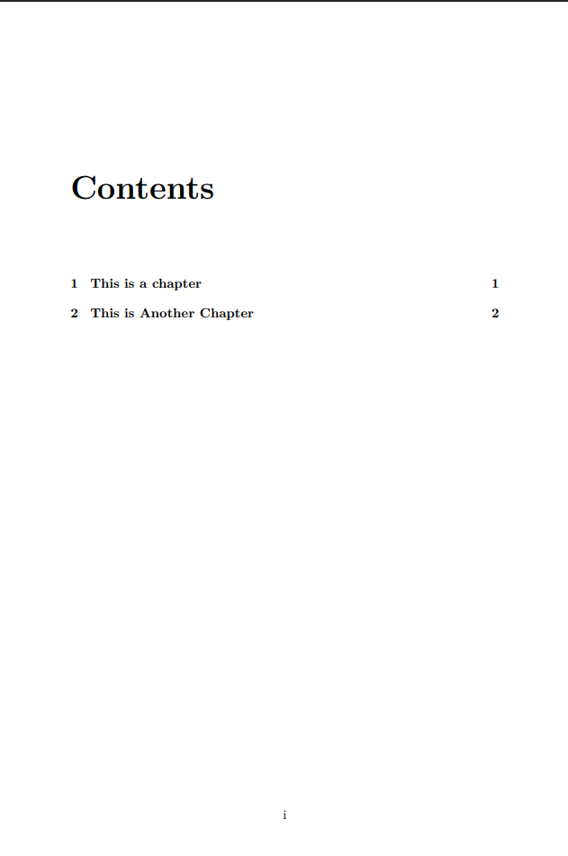
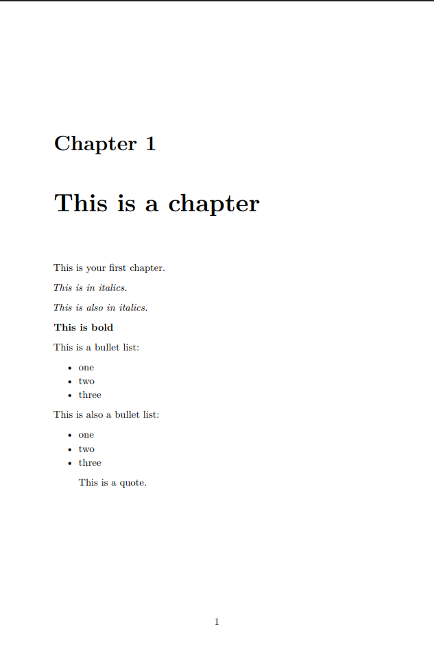
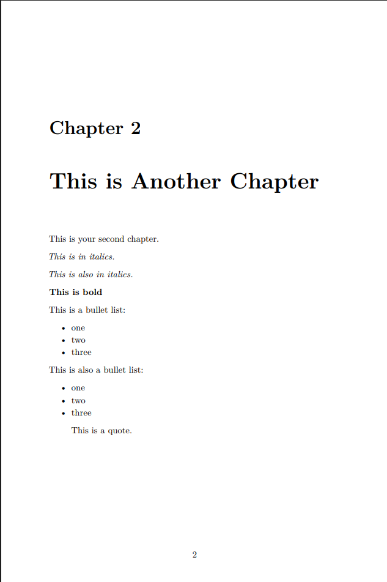
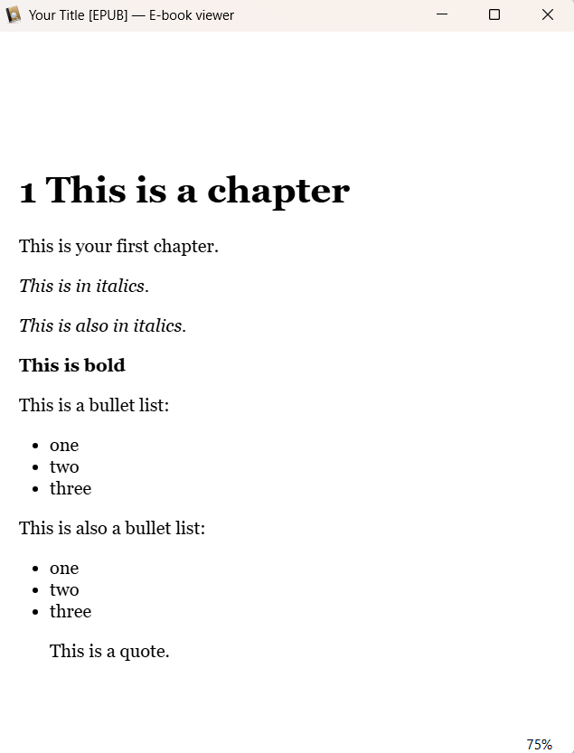

# Tutorial for a free book-writing and publishing environment

A tutorial, with examples, for a free writing environment using existing, well-supported tools.

Tools used:
- Obsidian
- Pandoc
- Git
- GitHub

This is a "do it yourself" process, of manually installing and setting up several different pieces of software on your computer. In the future I *may* write an automatically installer to set everything up automatically.

In lieu of a Patreon or other online tip jar, if you want to support this effort, see my author website and (if you like) buy a book. My books are very niche, and may not be for you, but they may be for your friends.

*Content Warning: these are adult books, recommended for readers 18+ readers only. Read the **full** list of warning tags on the website before purchasing the book! You've been warned.*

https://mabellbooks.com/books.html?ref=tutorial

## Installing Git

Git is used for keeping track of changes in your documents, and for syncing them up to GitHub for backing up the contents. It is a powerful tool intended to support full blown software development. It is a technical tool for technical folks, but we are not even going to be scratching the surface of its features here.

Install it from <a href="https://git-scm.com">https://git-scm.com</a>, following the instructions for your Windows, Mac, Linux, etc.

For convenience, if you are using Windows, install this: <a href="https://github.com/git-for-windows/git/releases/download/v2.56.0.windows.2/Git-2.56.0.2-64-bit.exe">https://github.com/git-for-windows/git/releases/download/v2.56.0.windows.2/Git-2.56.0.2-64-bit.exe</a>.

Once git has been installed, we are going to use it to download the file you are reading and the other sample files that are part of this project!

Open your operating system's terminal application (on Windows - "Command Prompt" on Mac or Linux - "Terminal") and run:


```
git clone https://github.com/mabellbooks/book-tutorial.git
cd book-tutorial
```

## Obsidian

This is your text editor, word processor, note-organizer. This is where you actually do you writing.

Get it at <a href="https://obsidian.md">https://obsidian.md</a>. Follow the instructions there to install it.

Once installed, run it and use its "Open folder as vault" feature to open the folder that you downloaded this tutorial into. You should see a structure like:

```
chapters
    001
    002
README
```



There is *so* much more to Obsidian than we will be covering here. See the <a href="https://obsidian.md/help/">Obsdian Help</a> for a full description of its features.

## Markdown

The beauty of the approach here, though, is you are *not* tied to Obsidian. Markdown files (files that end with .md that are the actual documents) are a plain text format that can be easily read/edited with many different applications, including a plain text editor like Notepad.



If you're an old school Unix person, you can use vi:



Or if you miss the days of MS-DOS, you can use "edit":



As you can see, all that is going is that certain characters like the hash (#) and the asterisk, underscore, and hyphen are being treated as formatting.  It is very easy to learn, and soon even in Obsidian you will find you can turn on "source mode" and just type the Markdown directly, rather than rely on the WYSIWYG capabilities.

The ability to use alternative and minimal editors is not just a stunt or a "fallback in case Obsidian stops working" (it won't!). It's a viable way to work. If you hit `alt+enter` while using "edit", for example, you will put it into a true fullscreen mode where it takes over the *entire* screen with just the text of the file you're editing - no more windows! - for a truly distraction free writing experience. People pay money for anti-distraction writing devices!

There are many good tutorials about Markdown online. Here are some:

- Obsidian's own tutorial here: <a href="https://obsidian.md/help/syntax">https://obsidian.md/help/syntax</a>
- Markdown Guide: <a href="https://www.markdownguide.org/">https://www.markdownguide.org/</a>
- literally just googling "markdown" at any time

## Pandoc

This is what you use when you want to take a multiple-file book (1 file per chapter, for example) and assemble into an EPUB for uploading to a store, or a PDF for sending to be printed, or a Word doc for a beta reader to make notes. It is almost too good at converting between formats.

In order to produce PDFs (and you *will* want to produce PDFs), you'll need to also install some variant of *LaTex*, which is the lower-level tool that Pandoc uses for formatting the PDF. The exact instructions for this are going to vary by operating system.

Full instructions are available at <a href="https://pandoc.org/installing.html">https://pandoc.org/installing.html</a>.

If those instructions are overwhelming, the following provides direct links to downloadable executables.

### Windows

1. Install Pandoc by downloading and running <a href="https://github.com/jgm/pandoc/releases/download/3.12.1/pandoc-3.12.1-windows-x86_64.msi">https://github.com/jgm/pandoc/releases/download/3.12.1/pandoc-3.12.1-windows-x86_64.msi</a>
2. Install MikTek (the LaTex engine) by downloading and running <a href="https://miktex.org/download/ctan/systems/win32/miktex/setup/windows-x64/basic-miktex-25.12-x64.exe">https://miktex.org/download/ctan/systems/win32/miktex/setup/windows-x64/basic-miktex-25.12-x64.exe</a>.


### Linux

*under construction*

### Mac

*under construction*

## Testing

In your command prompt, run the following:

```
pandoc README.md -o readme.pdf
```

If everything installed correctly, Pandoc will produce a PDF of this very tutorial. It might look something like the following:




## Specifying title, author, date, etc

Pandoc can uses YAML (Yet Another Markup Language) to control the formatting of the book. The YAML contents can be embedded in the Markdown files themselves, or it can be stored in a separate file.

The example here is called **defaults.yaml** and it contains:

```
metadata:
  title: Your Title
  author: Author Name
  lang: en-US
  date: '2026'

top-level-division: chapter

table-of-contents: true

number-sections: true

variables:
    documentclass: book
    classoption:
    - oneside
    linestretch: 1.15
    indent: false
    parskip: 6pt
    geometry:
      - paperwidth=6in
      - paperheight=9in
      - margin=0.75in
```

Go ahead and edit defaults.yaml using any text editor (notepad, for example), to set the title and author.

Full documentation of what all this means is available on the Pandoc website.


## Building a Book!

Now, everything is ready to create a full PDF of the "book" in this example.

On Mac or Linux, run:

```
pandoc chapters/*.md -o book.pdf -d defaults.yaml
```

On Windows, sadly, you cannot simply use a wildcard on the md files, you need to first combine the chapters into a single file for the whole book:

```
for %f in (*.md) do type "%f" >> book.md
pandoc book.md -o book.pdf -d defaults.yaml
```

If it works, you should have a fully formatted book with a title page, table of contents, and page-breaks between each chapter.

Either of these methods orders the chapters in _filename_ alphabetical order, which is why I named the files "001.md" and "002.md", to ensure they sort as expected.

Screenshots of the PDF, to show how it will look:

<div style="display: flex">




</div>


You have *a lot* of control over the format of the PDF using the YAML file. See the Pandoc website for full details. Or just google it - like Markdown, Pandoc is widely used and understood and discussed in many places online.

## Other Formats

Creating an EPUB or Word file is as easy as changing the name of the output file:


```
pandoc book.md -o book.epub -d defaults.yaml
pandoc book.md -o book.docx -d defaults.yaml
```

Example of how the EPUB might look in a reader:



## Convenience Scripts

I've provided "make.sh" (for Linux/Mac) and "make.bat" (for Windows). Running one of these will create the following from your book sources:

* PDF
* EPUB
* HTML
* Word

On Windows, simply run:

```
make.bat
```

On Linux/Mac, run:

```
./make.sh
```

And viola! You get your book, in multiple formats all at once.

## Versioning using Git

*under construction*

## Syncing with your own private GitHub repo

*under construction*
